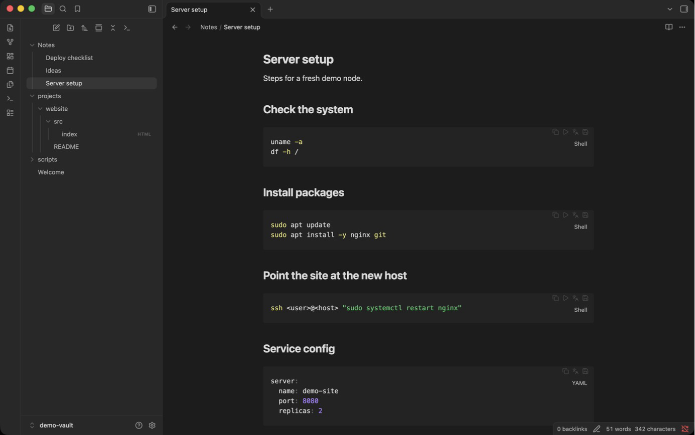
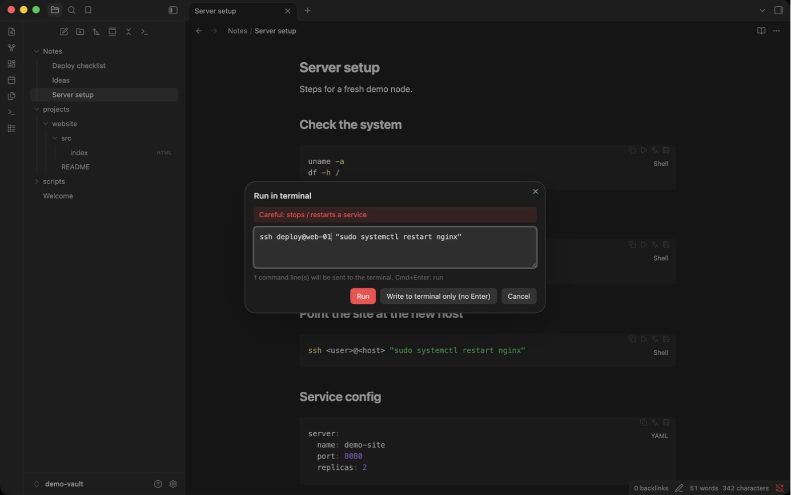
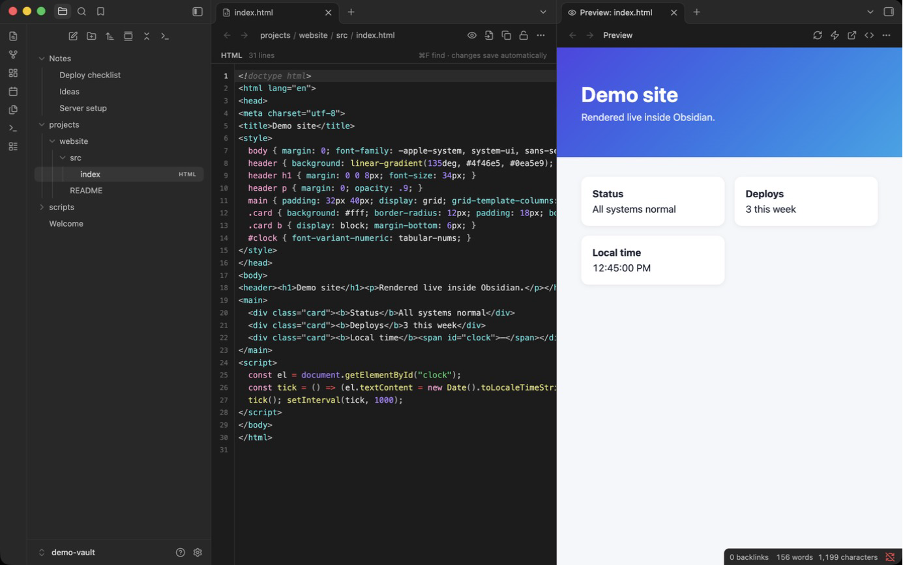

# ecu-codekit

Better code in your Obsidian notes: paste code and it lands in the right code block,
run commands straight from a note, edit code files with highlighting and preview HTML
side by side.



## Features

- **Paste detection**: paste a snippet and it is wrapped in a fenced code block with the
  right language (bash, Go, Python, YAML, JSON, SQL, Dockerfile, HTML and 20+ more).
  A small notice lets you change the language or keep it as plain text.
  `Cmd/Ctrl+Shift+V` pastes without detection.
- **Code block buttons** on every block: copy, run in terminal (shell blocks),
  change language, save as file.
- **Run in terminal** (needs [ecu-terminal](https://github.com/erencanucarr/ecu-terminal)):
  sends a block or the current line (`Cmd/Ctrl+Shift+Enter`) to the terminal. Prompts like
  `user@host $` and command output are stripped first. `<placeholders>` are filled in a
  small form, and risky commands (`rm -rf`, `reboot`, `kubectl delete`, …) ask before running.
- **Code files**: `.sh .go .py .yaml .json .sql .conf .log` and more open in a CodeMirror
  editor with highlighting, search, a read-only lock and a "run this script" button.
- **HTML preview**: right-click an `.html` file and choose **Preview** or
  **Preview beside**. The preview reloads when the file changes, runs in a
  sandbox that can't reach Obsidian or your files, and JavaScript can be switched off.
- **Save a block as a file** into a folder of your choice, with a link back in the note.





## Install

1. Download or clone this repository into `<your vault>/.obsidian/plugins/ecu-codekit`:

   ```sh
   cd "<your vault>/.obsidian/plugins"
   git clone https://github.com/erencanucarr/ecu-codekit.git
   ```

2. In Obsidian, open **Settings > Community plugins**, turn off Restricted mode if needed,
   and enable **ecu-codekit**.
3. Optional: install [ecu-terminal](https://github.com/erencanucarr/ecu-terminal) to run
   commands from notes.

## Commands

All of these are in the command palette and in the right-click menu of a code block:
paste as code, wrap selection in a code block, change language, copy block, save block as
file, unwrap block, run line / block in terminal, new code file, insert a code file into a
note, preview HTML beside, toggle paste detection.

## Language

The interface is available in English and Turkish. By default it follows Obsidian's
language; you can pick one under **Settings > ecu-codekit > Language**.

## License

MIT, see [LICENSE](LICENSE).
